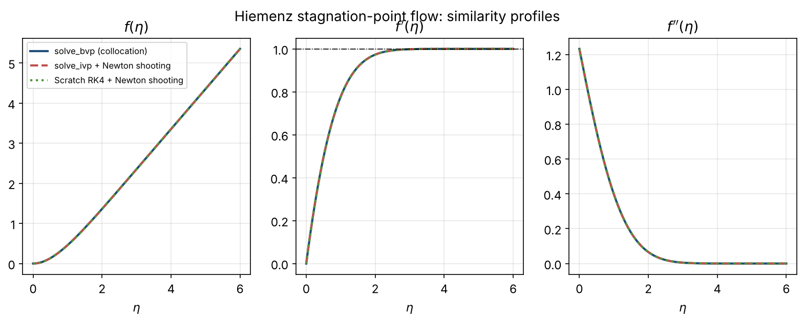
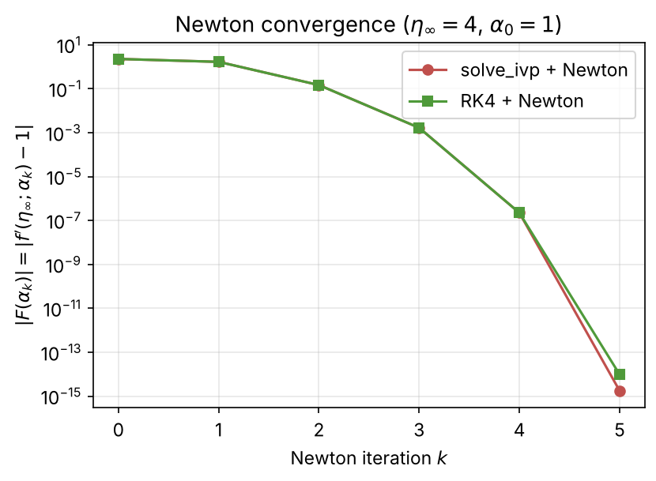
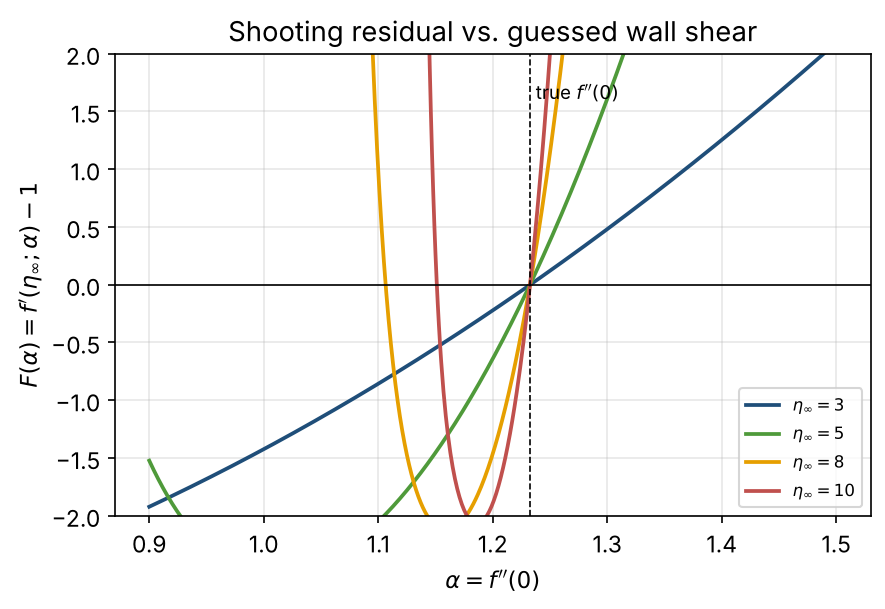
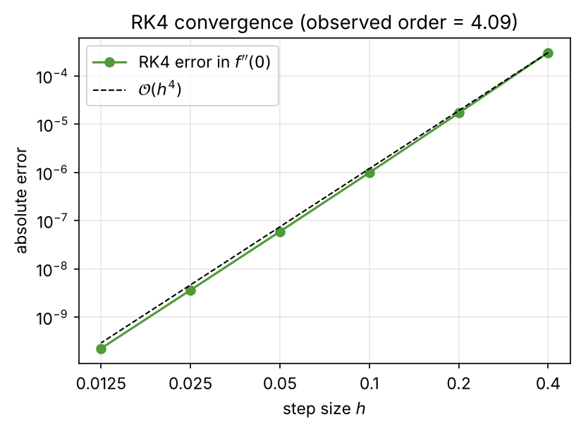
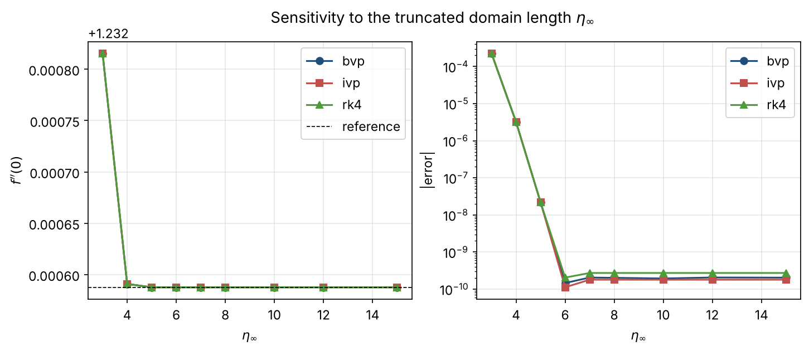
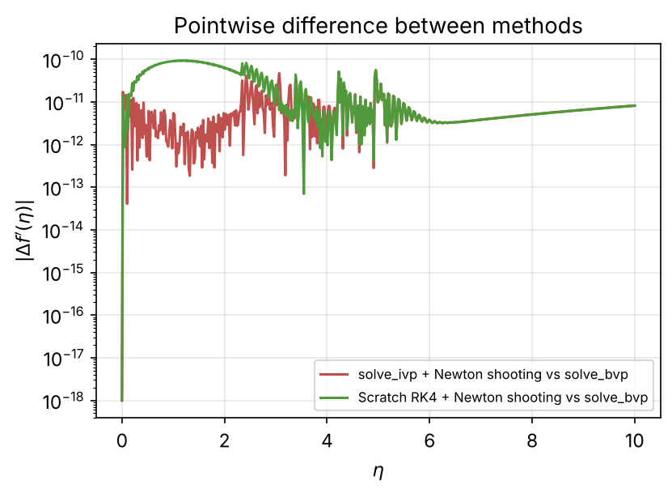

# Assignment 01 — Falkner–Skan Stagnation-Point (Hiemenz) Flow

**Name:** Aayush Verma  **Roll No.:** 24JE0239  **Branch:** B.Tech Mechanical Engineering, IIT (ISM) Dhanbad

Numerical solution of the similarity equation for 2-D laminar flow towards a stagnation point:

```
f''' + f f'' − (f')² + 1 = 0
f(0) = 0,   f'(0) = 0,   f'(η → ∞) = 1
```

The problem is solved with three independent methods, and the results are compared:

| # | Method | File |
|---|--------|------|
| 1 | Global collocation with `scipy.integrate.solve_bvp` | `src/method_bvp.py` |
| 2 | Shooting with `scipy.integrate.solve_ivp` (DOP853) + Newton–Raphson | `src/method_shooting_scipy.py` |
| 3 | Shooting with a **hand-written RK4** integrator + Newton–Raphson (no SciPy) | `src/method_shooting_rk4.py` |

Both shooting methods get the Newton derivative exactly, by integrating the variational (sensitivity) equations alongside the ODE. They also use **continuation in η∞**, because naive shooting on a long domain converges to a spurious root (see the report, §2.2).

## Key results (η∞ = 10)

| Method | f''(0) | \|error\| | δ* | θ |
|---|---|---|---|---|
| solve_bvp | 1.23258766 | 1.9e-10 | 0.6479 | 0.2923 |
| solve_ivp + Newton | 1.23258766 | 1.8e-10 | 0.6479 | 0.2923 |
| RK4 + Newton | 1.23258766 | 2.7e-10 | 0.6479 | 0.2923 |

Literature value: f''(0) = 1.232587657. The observed RK4 order of accuracy is **4.09**.

## Repository layout

```
Assignment_01_24JE0239/
├── main.py                       # runs everything, makes all figures and tables
├── src/
│   ├── problem.py                # ODE system, Jacobian, sensitivity system
│   ├── method_bvp.py             # Method 1: solve_bvp
│   ├── method_shooting_scipy.py  # Method 2: solve_ivp + Newton shooting
│   └── method_shooting_rk4.py    # Method 3: scratch RK4 + Newton shooting
├── report/
│   ├── report.tex                # LaTeX source of the report
│   ├── figures/                  # generated plots (PNG)
│   └── tables/                   # generated LaTeX tables
├── REPORT.pdf                    # compiled report
├── requirements.txt
└── README.md
```

## Setup

```bash
git clone https://github.com/Magachuu/Assignment_01_24JE0239.git
cd Assignment_01_24JE0239
python -m venv .venv
source .venv/bin/activate          # Windows: .venv\Scripts\activate
pip install -r requirements.txt
```

## Running

Run everything (about 15 s). This regenerates `report/figures/*.png` and `report/tables/*.tex`:

```bash
python main.py
```

Or run one method at a time:

```bash
python -m src.method_bvp
python -m src.method_shooting_scipy
python -m src.method_shooting_rk4
```

To rebuild the PDF after running `main.py`:

```bash
cd report && latexmk -pdf report.tex && cp report.pdf ../REPORT.pdf
```

## Figures

| | |
|---|---|
|  |  |
| Similarity profiles f, f′, f″ | Newton convergence (quadratic) |
|  |  |
| Shooting residual: spurious roots for large η∞ | RK4 error vs step size (order ≈ 4) |
|  |  |
| Sensitivity to η∞ | Pointwise difference between methods |
